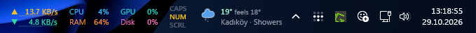
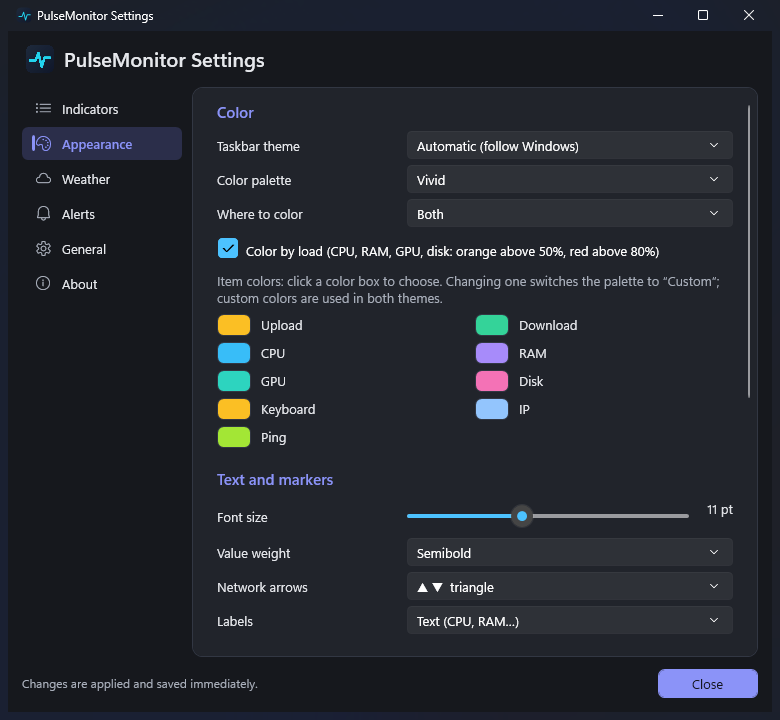
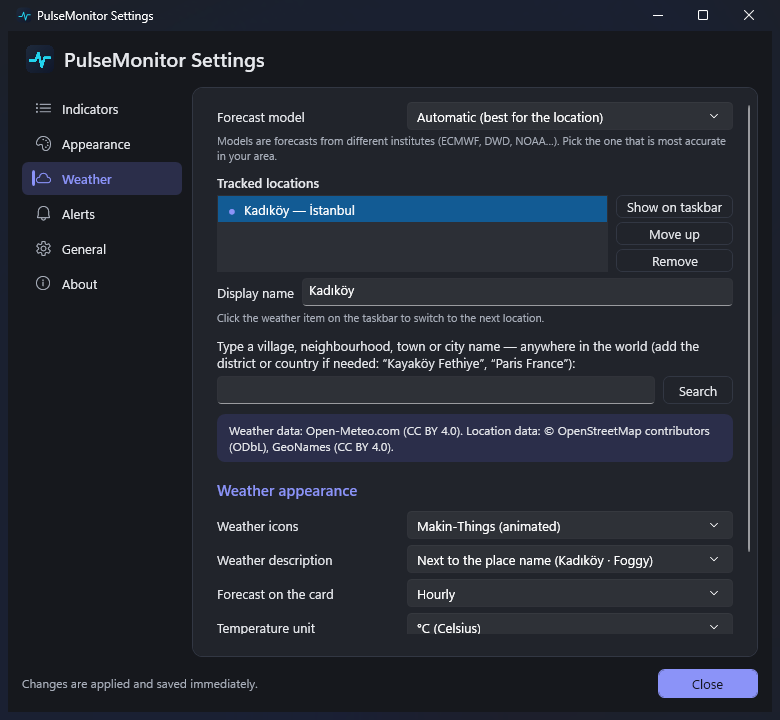
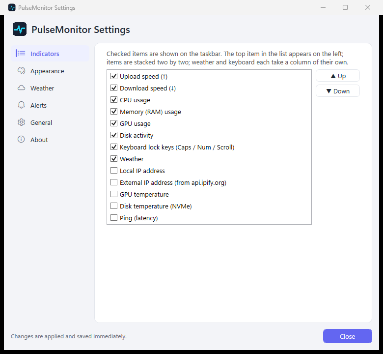
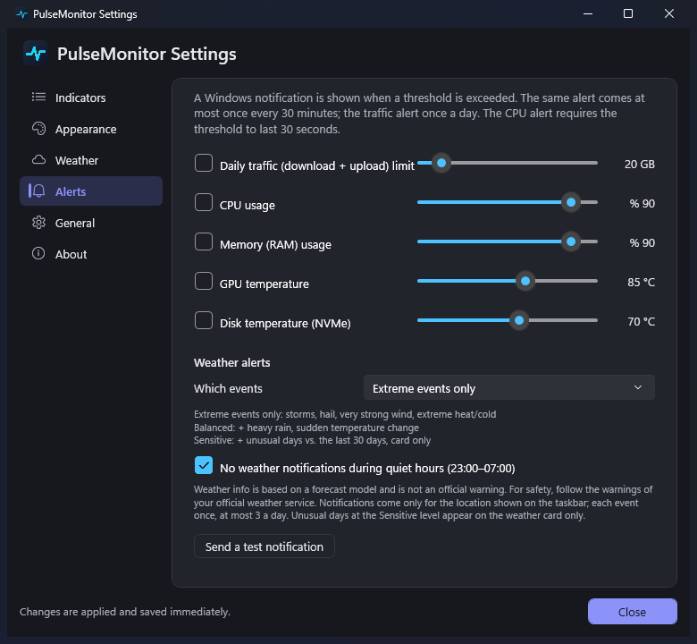
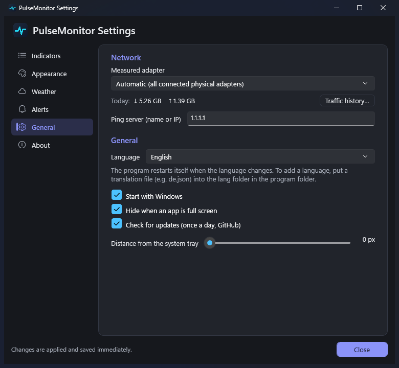
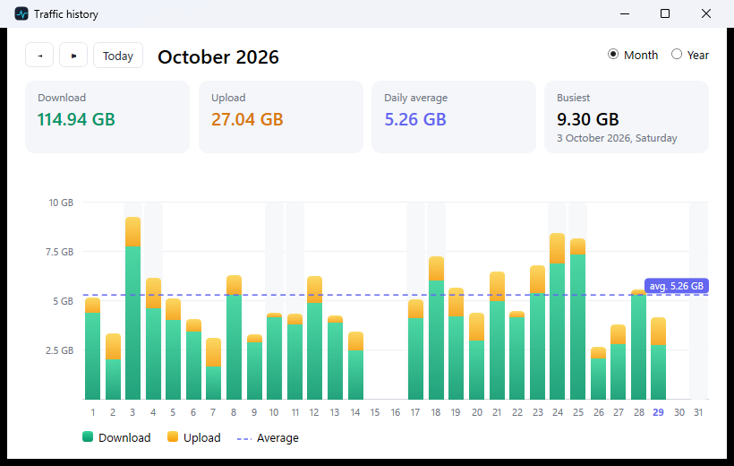

# PulseMonitor

**English** · [Türkçe](README.tr.md)

A lightweight system monitor for the Windows 11 taskbar: network speed, CPU/RAM/GPU/disk, temperatures, ping, IP,
keyboard lock keys and weather down to village/neighbourhood level. Inspired by
[TrafficMonitor](https://github.com/zhongyang219/TrafficMonitor); written from scratch in C# / WPF (.NET 10).
The interface is available in 22 languages.




## Installation

1. Download **`PulseMonitor-Setup-<version>.exe`** from the [Releases](https://github.com/omeryol/PulseMonitor/releases/latest) page.
2. Run it and click "Next". No administrator rights are needed; it installs into your user folder and adds a Start menu entry.
   If the .NET 10 Desktop Runtime is missing, the installer downloads it from Microsoft and installs it (it may ask once).
3. The program appears on the taskbar, left of the clock. Settings: right-click → **Settings…** or double-click the tray icon.

> **"Windows protected your PC" warning:** the installer is not code-signed yet. Click **More info → Run anyway**
> to continue. The file is built from the code in this repository on GitHub's own build servers (Actions).

To try it without installing, use **`PulseMonitor-<version>-portable.zip`**: extract it to a folder and run `PulseMonitor.exe`
(requires the [.NET 10 Desktop Runtime](https://dotnet.microsoft.com/download/dotnet/10.0)).

Uninstall: Windows Settings → Apps → PulseMonitor → Uninstall (you are asked whether to delete settings and history).

## Screenshots

| Appearance | Weather |
|---|---|
|  |  |
| **Indicators** | **Alerts** |
|  |  |
| **General (language)** | **Traffic history** |
|  |  |

Screenshots are generated with sample data.

## Features

- **Built into the taskbar**: sits left of the system tray by itself and moves when the tray grows; hides while an app
  is full screen; recovers when Explorer restarts; no flicker (value columns have a fixed width).
- **Indicators** (each can be turned on/off and reordered): upload/download speed (with a mini chart behind the value),
  CPU, RAM, GPU, disk activity, GPU and NVMe temperature, ping, local/external IP, Caps/Num/Scroll Lock, weather.
- **Weather**: search villages, neighbourhoods and towns anywhere in the world (Open-Meteo + OpenStreetMap; places in
  your own country first); forecast for the chosen spot with an hourly strip; feels-like temperature, description, °C/°F;
  9 icon sets, 4 of them animated (Meteocons, Makin-Things).
- **Appearance**: theme, palette and per-item colors, color by load, font size/weight, arrow and label style, column cards,
  opacity, spacing, scale.
- **Languages**: English, Turkish, German, Spanish, French, Italian, Portuguese, Russian, Ukrainian, Polish, Dutch, Japanese, Korean,
  Indonesian, Vietnamese, Thai, Czech, Swedish, Hungarian, Romanian, Greek and Simplified Chinese; picked automatically from the Windows language, changeable from the menu. Adding a
  language needs no code: copy `lang/tr.json`, translate the values, save it as e.g. `lang/de.json` and put it into the
  `lang` folder next to `PulseMonitor.exe`. Missing texts fall back to English.
- **Traffic history**: daily records, month/year chart.
- **Alerts**: Windows notifications for a daily traffic limit, CPU, RAM, GPU/disk temperature; new version notification.
- **Detail cards**: hover over an item for item-specific details (can be turned off).
- **Lightweight**: software rendering, ~60 MB of memory, ~1–4% of a single core.
- **No drivers**: no kernel driver and no administrator rights; nothing that would trigger an antivirus warning.
  That is why CPU temperature is not shown (desktop CPUs cannot be read without a driver).

## Requirements

- Windows 10 1809+ / Windows 11
- [.NET 10 Desktop Runtime](https://dotnet.microsoft.com/download/dotnet/10.0) (.NET 10 SDK to build)

## Building from source

```powershell
dotnet build -c Debug
powershell -ExecutionPolicy Bypass -File tools\build_release.ps1  # artifacts\: installer + portable zip (needs Inno Setup 6)
```

Releases: pushing a `v<version>` tag makes GitHub Actions (`.github/workflows/release.yml`) build the installer and
the zip and attach them to Releases.

`PulseMonitor.exe --exit` closes the running copy after saving its data.

## Privacy and network requests

Settings, traffic history and cache are kept only under `%LOCALAPPDATA%\PulseMonitor`. The program connects to:

| Service | When |
|---|---|
| Open-Meteo (forecast) | Every 15 minutes while weather is on |
| Open-Meteo + OpenStreetMap Nominatim (location search) | Only when you press "Search" in the settings |
| api.ipify.org (external IP) | Only while the "External IP" item is on |
| Ping server (default 1.1.1.1) | Only while the "Ping" item is on |
| GitHub (latest version number) | Once a day; can be turned off in Settings → General |

## Thanks

This project is inspired by the open-source [TrafficMonitor](https://github.com/zhongyang219/TrafficMonitor) project
(MIT) by [zhongyang219](https://github.com/zhongyang219). The feature set and the idea of living in the taskbar come from
TrafficMonitor; PulseMonitor is its own code, and no code was copied from TrafficMonitor. Many thanks to the
TrafficMonitor developers for their work.

## License

[MIT](LICENSE). Bundled icons and the data services used: [THIRD-PARTY-NOTICES.md](THIRD-PARTY-NOTICES.md).
