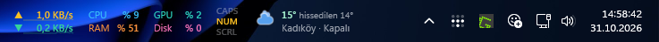
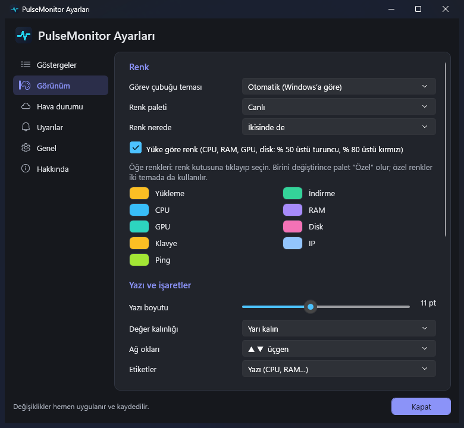
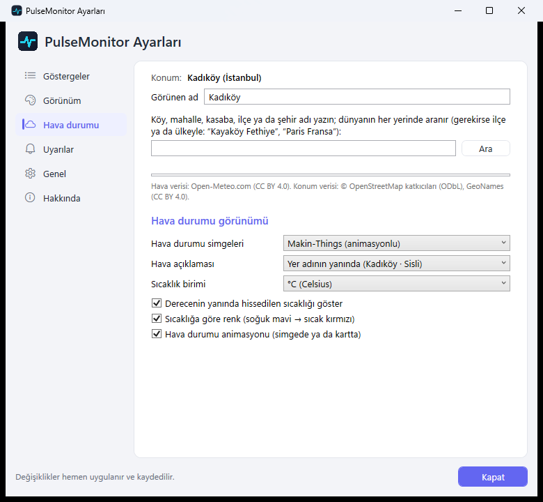
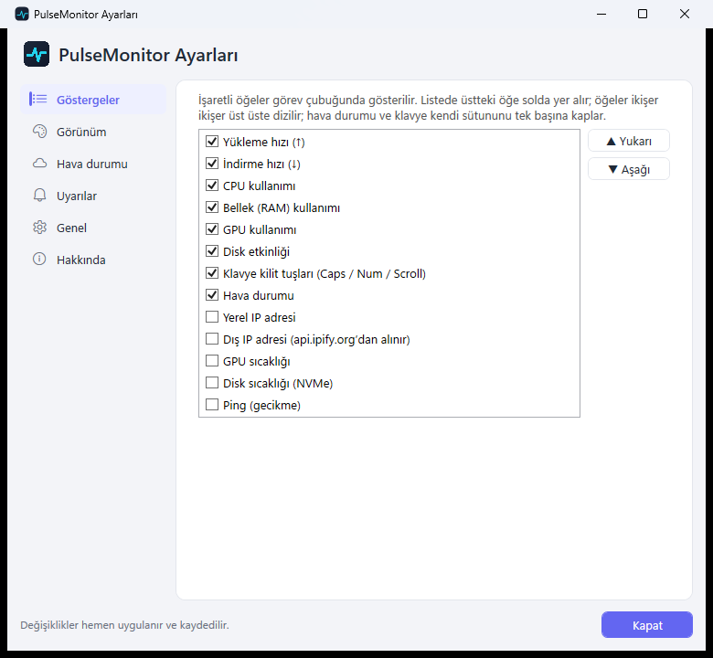
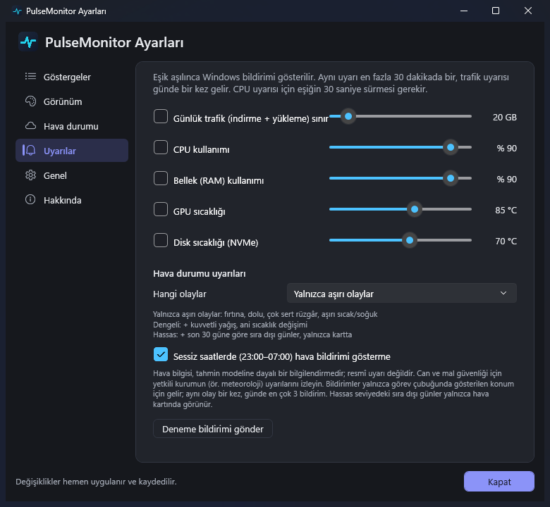
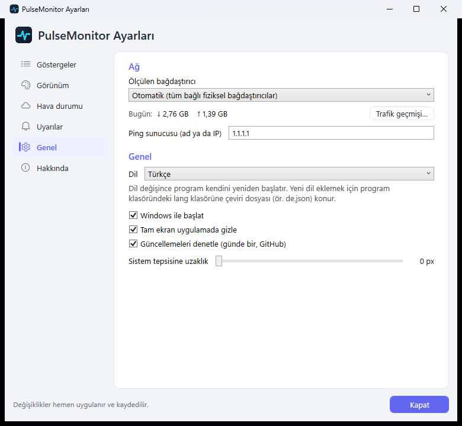
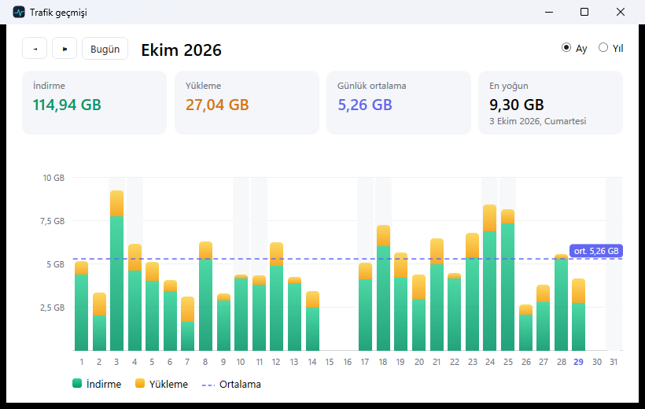

# PulseMonitor

[English](README.md) · **Türkçe**

Windows 11 görev çubuğu için hafif bir sistem monitörü: ağ hızı, CPU/RAM/GPU/disk, sıcaklıklar, ping, IP,
klavye kilit tuşları ve köy/mahalle düzeyinde hava durumu. [TrafficMonitor](https://github.com/zhongyang219/TrafficMonitor)'dan
esinlenilmiştir; C# / WPF (.NET 10) ile sıfırdan yazılmıştır. Arayüz 12 dildedir.




## Kurulum

1. [Releases](https://github.com/omeryol/PulseMonitor/releases/latest) sayfasından **`PulseMonitor-Setup-<sürüm>.exe`** dosyasını indirin.
2. Çalıştırıp "İleri" ile kurun. Yönetici yetkisi istemez; kullanıcı klasörüne kurulur, Başlat menüsüne eklenir.
   Bilgisayarda .NET 10 Masaüstü Çalışma Zamanı yoksa kurulum onu Microsoft'tan indirip kurar (tek bir onay isteyebilir).
3. Program görev çubuğunda, saatin solunda belirir. Ayarlar: sağ tık → **Ayarlar…** ya da tepsi simgesine çift tık.

> **"Windows bilgisayarınızı korudu" uyarısı:** kurulum dosyası henüz kod imzalı değildir. **Ek bilgi → Yine de çalıştır**
> ile devam edin. Dosyanın kaynağı bu depodaki kod ve GitHub'ın kendi derleme sunucusudur (Actions).

Kurmadan denemek için **`PulseMonitor-<sürüm>-portable.zip`**: zip'i bir klasöre açıp `PulseMonitor.exe`'yi çalıştırın
([.NET 10 Masaüstü Çalışma Zamanı](https://dotnet.microsoft.com/download/dotnet/10.0) gerekir).

Kaldırma: Windows Ayarları → Uygulamalar → PulseMonitor → Kaldır (ayarların ve geçmişin silinip silinmeyeceği sorulur).

## Ekran görüntüleri

| Görünüm ayarları | Hava durumu |
|---|---|
|  |  |
| **Göstergeler** | **Uyarılar** |
|  |  |
| **Genel (dil seçimi)** | **Trafik geçmişi** |
|  |  |

Görüntüler örnek verilerle üretilmiştir.

## Özellikler

- **Görev çubuğuna gömülü**: sistem tepsisinin soluna kendiliğinden yerleşir, tepsi genişleyince kayar; tam ekran
  uygulamada gizlenir; Explorer yeniden başlarsa toparlanır; titremez (değer sütunları sabit genişlikte).
- **Göstergeler** (her biri ayrı açılır/kapanır, sırası ayarlanır): yükleme/indirme hızı (değerin arkasında mini grafik),
  CPU, RAM, GPU, disk etkinliği, GPU ve NVMe sıcaklığı, ping, yerel/dış IP, Caps/Num/Scroll Lock, hava durumu.
- **Hava durumu**: dünyanın her yerinde köy, mahalle, kasaba araması (Open-Meteo + OpenStreetMap; kendi ülkendeki yerler
  önce); seçilen noktanın tahmini, saatlik şerit; hissedilen sıcaklık, açıklama, °C/°F; 9 simge seti, 4'ü animasyonlu (Meteocons, Makin-Things).
- **Görünüm**: tema, palet ve öğe başına renk, yüke göre renk, yazı boyutu/kalınlığı, ok ve etiket biçimi, sütun kartları,
  saydamlık, aralıklar, ölçek.
- **Dil**: Türkçe, İngilizce, Almanca, İspanyolca, Fransızca, İtalyanca, Portekizce, Rusça, Ukraynaca, Lehçe,
  Felemenkçe ve basitleştirilmiş Çince; Windows diline göre kendiliğinden seçilir, menüden değiştirilir. Yeni dil için kod
  gerekmez: `lang/tr.json` kopyalanıp çevrilir (`lang/de.json` gibi), program klasöründeki `lang` klasörüne konur.
- **Trafik geçmişi**: günlük kayıt, ay/yıl grafiği.
- **Uyarılar**: günlük trafik sınırı, CPU, RAM, GPU/disk sıcaklığı için Windows bildirimi; yeni sürüm bildirimi.
- **Ayrıntı kartları**: her kartın üzerine gelince öğeye özel bilgiler (açılıp kapatılabilir).
- **Hafif**: işlemciyle çizim, ~60 MB bellek, tek çekirdeğin ~% 1–4'ü.
- **Sürücüsüz**: çekirdek sürücüsü yoktur, yönetici yetkisi istemez; antivirüs uyarısına yol açacak bileşen içermez.
  Bu yüzden CPU sıcaklığı gösterilmez (masaüstü işlemcilerde sürücüsüz okunamıyor).

## Gereksinimler

- Windows 10 1809+ / Windows 11
- [.NET 10 Desktop Runtime](https://dotnet.microsoft.com/download/dotnet/10.0) (derlemek için .NET 10 SDK)

## Kaynaktan derleme

```powershell
dotnet build -c Debug
powershell -ExecutionPolicy Bypass -File tools\build_release.ps1  # artifacts\: kurulum dosyası + taşınabilir zip (Inno Setup 6 gerekir)
```

Sürüm yayını: `v<sürüm>` etiketi gönderilince GitHub Actions (`.github/workflows/release.yml`) kurulum dosyasını ve
zip'i derleyip Releases'a ekler.

`PulseMonitor.exe --exit` çalışan kopyayı veriyi kaydederek kapatır.

## Gizlilik ve ağ istekleri

Ayarlar, trafik geçmişi ve önbellek yalnızca `%LOCALAPPDATA%\PulseMonitor` altında tutulur. Program şu adreslere bağlanır:

| Servis | Ne zaman |
|---|---|
| Open-Meteo (tahmin) | Hava durumu açıkken 15 dakikada bir |
| Open-Meteo + OpenStreetMap Nominatim (konum araması) | Yalnızca ayarlarda "Ara"ya basınca |
| api.ipify.org (dış IP) | Yalnızca "Dış IP" öğesi açıkken |
| Ping sunucusu (varsayılan 1.1.1.1) | Yalnızca "Ping" öğesi açıkken |
| GitHub (son sürüm numarası) | Günde bir; Ayarlar → Genel'den kapatılabilir |

## Teşekkür

Bu proje, [zhongyang219](https://github.com/zhongyang219)'ın açık kaynak [TrafficMonitor](https://github.com/zhongyang219/TrafficMonitor)
projesinden (MIT) esinlenmiştir. Özellik seti ve görev çubuğuna yerleşme fikri TrafficMonitor'a dayanır; PulseMonitor
kendi kodundan oluşur, TrafficMonitor'dan kod kopyalanmamıştır. Emeği için TrafficMonitor geliştiricilerine teşekkürler.

## Lisans

[MIT](LICENSE). Dahil edilen simgeler ve kullanılan veri servisleri: [THIRD-PARTY-NOTICES.md](THIRD-PARTY-NOTICES.md).
